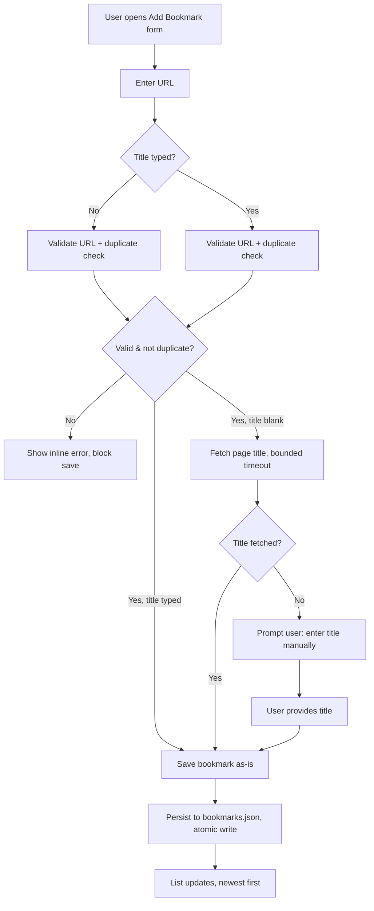
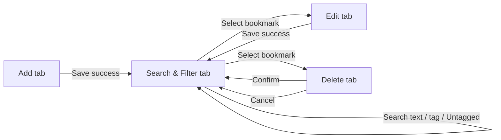

# Design – Personal Bookmark Manager with Tagging

This document translates the requirements captured in [01-planning.md](01-planning.md) into a
concrete technical design.

## Proposed Solution

**Architecture** — a single self-hosted web application, layered so each concern is testable
in isolation and the persistence layer can be swapped without touching business logic:

```
Browser (HTML/CSS/vanilla JS SPA-lite)
        │  fetch() calls, JSON over HTTP
        ▼
ASP.NET Core Minimal API (Presentation)
        │
        ▼
Service Layer  — BookmarkService, TitleFetchService, UrlValidator, TagNormalizer
        │
        ▼
IBookmarkRepository (interface)
        │
        ▼
JsonBookmarkRepository — in-memory cache + bookmarks.json (atomic write)
```

**Project structure**

```
BookmarkManager/
├─ src/
│  ├─ BookmarkManager.Api/            # ASP.NET Core Minimal API host
│  │  ├─ Endpoints/                   # BookmarkEndpoints.cs (maps /api/bookmarks routes)
│  │  ├─ wwwroot/                     # static SPA-lite frontend (index.html, app.js, styles.css)
│  │  ├─ Program.cs
│  │  └─ appsettings.json
│  ├─ BookmarkManager.Core/           # Domain + services (no ASP.NET dependency)
│  │  ├─ Common/Result.cs             # generic Result<T> success/failure type
│  │  ├─ Models/Bookmark.cs
│  │  ├─ Repositories/IBookmarkRepository.cs
│  │  ├─ Services/AddBookmarkRequest.cs
│  │  ├─ Services/BookmarkService.cs
│  │  ├─ Services/ITitlePageFetcher.cs    # Adapter interface
│  │  ├─ Services/HttpTitlePageFetcher.cs # Adapter impl: SSRF guard, timeout, size cap, redirects
│  │  ├─ Services/TitleFetchService.cs
│  │  ├─ Validation/UrlValidator.cs
│  │  └─ Validation/TagNormalizer.cs
│  └─ BookmarkManager.Persistence/    # JsonBookmarkRepository, atomic file writer
└─ tests/
   └─ BookmarkManager.Tests/          # xUnit unit tests for Core + Persistence
```

**Technology choices**

| Choice | Reason it fits this problem |
|---|---|
| .NET 8 / ASP.NET Core Minimal API | Free, cross-platform, runs locally with `dotnet run`, no paid cloud dependency; Minimal API keeps a single-user CRUD surface lightweight compared to full MVC. |
| Vanilla HTML/CSS/JS static frontend (served from `wwwroot`) | Avoids a Node build toolchain and framework overhead for a small single-user app; keeps "start and be usable in 5 seconds" easy to hit; still gives full control over accessibility markup. |
| `System.Text.Json` for the data file and API payloads | Built into .NET, no extra dependency, fast enough for the 1,000-record target. |
| JSON flat file (`bookmarks.json`) via a repository interface | Satisfies "no external database/paid service" while still giving durable, restart-surviving storage; interface boundary keeps the design swappable (see Alternatives). |
| `IHttpClientFactory` + `HttpClient` (bounded timeout, max response size) for title fetch | Standard, testable way to make outbound calls with the pooling/timeout/SSRF controls the NFRs require. |
| Regex/streaming `<title>` extraction (no full HTML DOM parser dependency) | Only the `<title>` tag is needed; avoids pulling in a heavier HTML-parsing library and reduces the dependency-safety surface (Security Design). |
| xUnit | Standard .NET unit-test framework, supports the "core domain logic is covered by automated tests" maintainability goal. |

**Design patterns**

| Pattern | Where it applies |
|---|---|
| Repository | `IBookmarkRepository` / `JsonBookmarkRepository` isolate `BookmarkService` from the JSON file, so persistence can be swapped (SQLite, etc.) without touching business logic. |
| Result / Either | `Result<T>` (`Common/Result.cs`) is used throughout `UrlValidator`, `TagNormalizer`, `HttpTitlePageFetcher`, and `BookmarkService` to return a typed success/failure outcome instead of throwing, so callers can branch on failure (e.g. prompt for manual title) without exceptions-as-control-flow. |
| Adapter | `ITitlePageFetcher` wraps `HttpClient` plus `<title>` extraction and the SSRF/timeout/size-cap guards, so the fetch mechanics are swappable and fakeable in tests. |
| Singleton (via DI) | `JsonBookmarkRepository` is registered as a singleton service so the app has exactly one in-memory list and one `SemaphoreSlim`, which the atomic-write correctness in the Data Model section depends on. |

*Not currently implemented as formal patterns*: the Add/Edit save flow (`BookmarkService.ValidateAsync`) runs
as a **sequential validation flow with early returns** — format check → scheme allow-list → tag
normalization → duplicate check → title fetch — rather than a composable Chain of Responsibility
of handler objects, and `UrlValidator.Normalize` is one monolithic method rather than swappable
Strategy objects. Both resemble those patterns in spirit but are described here as what they
actually are, since the code does not contain the handler/strategy interfaces those pattern names
would imply. There is also no `BookmarkService.SaveAsync` Template Method — `AddAsync` and
`UpdateAsync` each call the shared private `ValidateAsync` helper directly.

## Data Model

Single entity, persisted as a JSON array — no separate database schema is needed, so this
section documents the equivalent persistence design instead of a relational schema.

**`Bookmark` entity**

| Field | Type | Notes |
|---|---|---|
| `Id` | `Guid` | Server-generated, immutable, used for edit/delete lookups. |
| `Url` | `string` | Original, user-entered URL (as typed, for display). |
| `NormalizedUrl` | `string` | Lowercased scheme/host, trimmed trailing slash — used only for duplicate comparison, never displayed. |
| `Title` | `string` | Either user-typed or fetched; never `null`/placeholder — save is blocked until a real value exists. |
| `Tags` | `List<string>` | Normalized (trimmed, lowercased, deduped) free-text tags; empty list is valid. |
| `CreatedAt` | `DateTimeOffset` (UTC) | Set once on create; drives newest-first sort. |
| `UpdatedAt` | `DateTimeOffset` (UTC) | Set on every edit. |

**Relationships** — tags are modeled as a string list embedded on each bookmark rather than a
separate `Tag` table with a join table, because the store is a flat JSON file, not a relational
database:

- The set of "all existing tags" (for the filter dropdown) is derived at read time by
  distinct-unioning every bookmark's `Tags`.
- The built-in "Untagged" filter is virtual — it is not a stored tag, just a query
  `Tags.Count == 0`.
- This is logically equivalent to a many-to-many relationship (a tag string can appear on many
  bookmarks, a bookmark can have many tags) without the overhead of a second collection/table.

**Persistence design — how bookmarks survive an application restart**

0. The JSON file path is configurable via the `BookmarksFilePath` setting in `appsettings.json`
   (defaults to `bookmarks.json` relative to the content root), so the data location can be
   changed per environment without a code change.
1. On startup, `JsonBookmarkRepository` reads `bookmarks.json` (if present) once and deserializes
   it into an in-memory `List<Bookmark>` guarded by a `SemaphoreSlim` for single-writer safety.
2. Every create/update/delete mutates the in-memory list, then saves it safely using a
   "write to a new file, then swap" pattern instead of editing `bookmarks.json` directly:
   - Serialize the *entire* updated list to a separate new file, `bookmarks.json.tmp`.
   - Once that write finishes successfully, rename `bookmarks.json.tmp` to `bookmarks.json`
     (`File.Move(..., overwrite: true)`), replacing the old file in one step.
   The rename is atomic (the OS either completes it fully or not at all), so if the app
   crashes while writing the `.tmp` file, the original `bookmarks.json` is left untouched and
   still valid — there's no window where a partially-written file could be read back.
3. The API only returns success to the caller after the write completes, so an in-memory change
   is never reported as saved before it is durable on disk.
4. If `bookmarks.json` is missing on startup (first run), the repository initializes an empty
   list and creates the file on the first successful write — this is the "no bookmarks yet"
   empty state, not an error.

## UI / User Flow

**Screens / components**

- **Add tab** — URL field, optional Title field, tag input (chip-style), Save/Cancel, and inline validation messages.
- **Edit tab** — select an existing bookmark and update its URL, title, or tags.
- **Delete tab** — select an existing bookmark and show a confirmation safeguard before deletion.
- **Search & Filter tab** — search box (250 ms client-side debounce before triggering a server request), tag filter dropdown (incl. "Untagged"), bookmark cards, and empty-state messaging.
- **Shared Empty/Error State component** — reused by the relevant views so messaging stays consistent.

**API surface**

| Endpoint | Query parameters / body | Notes |
|---|---|---|
| `GET /api/bookmarks/` | `tag`, `untagged` (bool), `search` — all optional | Returns bookmarks newest-first, filtered by tag or "Untagged" (`untagged=true`), and/or a case-insensitive title/URL search term. |
| `POST /api/bookmarks/` | JSON body `{ url, title, tags }` | Runs the Add validation pipeline; `201 Created` or `400 Bad Request` with `{ error }`. |
| `PUT /api/bookmarks/{id}` | JSON body `{ url, title, tags }` | Runs the Edit validation pipeline (excludes self from the duplicate check); `200 OK`, `400`, or `404`. |
| `DELETE /api/bookmarks/{id}` | — | `204 No Content` or `404`. |
| `GET /api/tags` | — | Distinct, alphabetically-sorted tags across all bookmarks; the "Untagged" option shown in the UI is added client-side and is not part of this endpoint's response. |

**Major user flow — add a bookmark (title auto-fetch)**



**Screen relationship**



## Error Handling

| Case | Handling | User feedback |
|---|---|---|
| Empty or malformed URL (e.g. `""`, `"htp:/bad"`, `javascript:` / `data:` scheme) | Rejected by `UrlValidator` before it reaches the service/repository layer; scheme allow-list (`http`/`https` only). Nothing is written to `bookmarks.json`. | Inline field error, e.g. "Enter a valid http(s) URL." Save button stays disabled/blocked. |
| Duplicate URL (create or edit) | `NormalizedUrl` compared against existing records (excluding the bookmark's own Id on edit) before save. | Inline message: "This URL is already saved." No new/second record is created. |
| Title-fetch failure (timeout, 4xx/5xx, non-HTML response, oversized body) | `TitleFetchService` returns a typed failure result instead of throwing or falling back to a placeholder; save is blocked. | "We couldn't get a title automatically — please enter one" plus a now-required Title field, save re-enabled once filled. |
| No bookmarks saved yet | Repository returns an empty list, which is a valid state, not an error. | Friendly first-run empty state: "No bookmarks yet — add your first one." |
| No search results / no tag matches (incl. "Untagged" with none) | Filter/search executes normally and returns an empty result set. | Distinct empty state: "No bookmarks match your search/filter" with a "Clear" action, visually different from the first-run empty state. |
| Rapid double-submit of Add (e.g., slow title fetch) | Duplicate validation runs before persistence, and repository writes are serialized by a `SemaphoreSlim` so two writes can't corrupt the file. However, the check-then-add sequence in `BookmarkService` is not itself covered by that lock, so two truly simultaneous requests for the same URL could both pass the duplicate check before either persists — a narrow race window that is not currently closed. Client-side, the Save button is disabled on first submit until the request settles, which covers the common single-tab double-click case. | Button shows a disabled/loading state; if a duplicate does slip through via the race window, the standard duplicate message is shown on the next save/edit. |
| Very long URL or tag input | Length-capped in the validator (URL ≤ 2048 chars, tag ≤ 50 chars) before persistence. There is currently no explicit length cap on the Title field. | Inline error naming the field and the limit, rather than a layout break or silent truncation. |

All error and empty-state messages are plain, non-technical language per the usability NFR, and
are rendered through the shared empty/error-state component so behavior is consistent across
list, search, and filter.

## Security Design

- **User-submitted URLs**: validated against an `http`/`https` scheme allow-list before any
  processing; anything else (`javascript:`, `data:`, `file:`, `ftp:`, etc.) is rejected at the
  validator, so it never reaches the title-fetch step or storage.
- **Title-fetch requests to external sites (SSRF protection)**: before issuing the outbound
  `HttpClient` request, the resolved host is checked against loopback/private/link-local IP
  ranges (`127.0.0.0/8`, `10.0.0.0/8`, `172.16.0.0/12`, `192.168.0.0/16`, `169.254.0.0/16`,
  IPv6 equivalents) and rejected if it resolves internally; the request uses a bounded timeout
  (5s) and a capped response size (1 MB) read via a limited stream, and every redirect hop (up
  to 5) is re-resolved and re-checked against the same host allow/deny rules before it is
  followed, so a redirect to a disallowed host is rejected rather than followed.
- **Fetched page titles**: treated as untrusted text — decoded from the HTML `<title>` element
  as plain text only (no markup is ever executed or stored as HTML), then HTML-encoded on
  output by the rendering layer (Razor's `@` encoding, or `textContent`/`innerText` — never
  `innerHTML` — in the vanilla-JS frontend) to prevent stored/reflected XSS.
- **User-typed tags and search/filter query text**: treated as plain literal strings, matched
  with case-insensitive substring/equality comparison in memory (`string.Contains`,
  `StringComparer.OrdinalIgnoreCase`) — since there is no SQL/NoSQL query language involved,
  there is no injection vector here; the same output-encoding rule as titles applies when tags
  or search terms are echoed back in the UI (e.g. "Showing results for '<term>'").
- **Dependency safety**: keep the dependency surface intentionally small (framework libraries +
  xUnit only, no HTML-parsing or scraping package); run `dotnet list package --vulnerable`
  (or Dependabot, if hosted on GitHub) periodically and before release to catch known CVEs in
  transitive packages.
- **No secrets/auth surface**: consistent with the single-user, local-only scope in
  01-planning.md — no credentials, API keys, or tokens are stored or required, removing an
  entire class of secret-leakage risk; if the app were ever exposed beyond localhost, the design
  note in Risks (01-planning.md) still applies — authentication would need to be added first.

## Meeting the Non-Functional Requirements

| NFR (from 01-planning.md) | How the design meets it |
|---|---|
| Performance: list/search/filter < 500 ms @ 1,000 bookmarks | All 1,000 records are held in memory after startup; search/filter run as an in-memory LINQ scan over a `List<Bookmark>` (`BookmarkService.GetAllAsync`), not a pre-built index. At the 1,000-record scale this is fast enough to meet the target without an external index/DB round-trip. A `Dictionary<string, List<Guid>>` tag index and `skip`/`take` pagination are potential future optimizations if volume grows well beyond 1,000, but neither is implemented today. |
| Reliability & persistence: zero data loss across restart, atomic writes | Covered in Data Model — write-to-temp-then-rename with `File.Move(overwrite: true)` and a single-writer semaphore ensure a crash mid-write cannot corrupt `bookmarks.json`, and startup always reloads the last durably-written state. The storage file path is configurable via `BookmarksFilePath` (see Data Model), so it can be pointed at a persistent location without a code change. |
| Availability: usable within 5 seconds of launch | Minimal API + a small static frontend have negligible startup cost; loading `bookmarks.json` into memory once at boot (rather than per-request) keeps first list render fast even at 1,000 records. |
| Usability: core actions within 2 interactions | The tab navigation surfaces Add/Edit/Delete/Search & Filter directly (1 click each); Add/Edit save and Delete confirm are each a single follow-up action (2nd interaction), matching the target. |
| Accessibility: WCAG 2.1 AA baseline | Static frontend uses semantic HTML (`<label for>`, `<button>`, `<nav>`), all interactive elements are native focusable controls (no click-only `<div>`s) for keyboard navigation, color palette is chosen for ≥4.5:1 contrast, and error/empty-state messages are rendered inside a region with both `role="status"` and `aria-live="polite"` so assistive tech announces them. |
| Security | See Security Design section above — scheme allow-list, SSRF guards, output encoding, bounded fetch, no secrets. |
| Maintainability: domain logic unit-tested, swappable persistence | `BookmarkManager.Core` (validation, duplicate detection, title fetch, tag normalization) has no ASP.NET or file-system dependency and is covered by xUnit tests; `IBookmarkRepository` isolates the JSON file behind an interface so tests can substitute an in-memory fake and the storage engine can be swapped (see Alternatives). |

## Alternatives & Tradeoffs

1. **Persistence: JSON flat file vs. SQLite vs. in-memory only**
   - *Options considered*: (a) plain JSON file with atomic rewrite, (b) embedded SQLite
     database file, (c) in-memory only (no persistence).
   - *Decision*: JSON flat file behind `IBookmarkRepository`.
   - *Trade-offs*: SQLite would give real transactional guarantees and cheap indexed queries
     as data grows, at the cost of an extra dependency (`Microsoft.Data.Sqlite`) and schema
     migrations for a single-entity app that doesn't need them yet. In-memory-only is simplest
     but fails the "survive a restart" requirement outright. JSON was chosen because it meets
     the durability requirement with the least moving parts at the 1,000-record scale, while the
     repository interface keeps a future move to SQLite (per the open question about datasets
     beyond 1,000) a contained change rather than a rewrite.

2. **Frontend: server-rendered Razor Pages vs. SPA framework (React/Vue) vs. vanilla JS static SPA-lite**
   - *Options considered*: (a) ASP.NET Core Razor Pages (full server round-trip per action),
     (b) a React/Vue SPA with its own build pipeline, (c) a small static HTML/CSS/vanilla-JS
     frontend calling the Minimal API via `fetch`.
   - *Decision*: vanilla JS static SPA-lite served from `wwwroot`.
   - *Trade-offs*: Razor Pages would reduce client-side code and centralize output-encoding, but
     adds full-page round trips for actions like search/filter, working against the snappy
     feel implied by the performance NFR. React/Vue give component structure and ecosystem
     tooling at 1,000+ bookmarks and beyond, but require Node/build tooling that isn't needed
     for a single-user local app and increases the dependency-safety surface (Security Design).
     Vanilla JS keeps the stack minimal and starts fast (Availability NFR), at the cost of more
     manual DOM/accessibility wiring than a framework would provide for free.

3. **Duplicate URL handling: hard block vs. warn-and-allow-override**
   - *Options considered*: (a) hard-block save whenever a normalized duplicate exists,
     (b) show a warning but let the user save anyway.
   - *Decision*: hard block (resolving the open question in 01-planning.md in favor of
     stricter data integrity for v1).
   - *Trade-offs*: Blocking guarantees no accidental duplicate clutter and keeps duplicate
     detection simple (a single normalized-URL comparison, no override state to track), but
     removes the legitimate (if rare) case where a user genuinely wants two entries for the same
     URL with different tags/titles. Warn-and-override would satisfy that edge case but adds UI
     complexity (a second confirmation path) and reintroduces the duplicate-clutter risk the
     requirement was meant to prevent; it can be revisited later without a data-model change
     since the check lives entirely in the service layer. Note: as documented in Error Handling,
     the current check-then-add sequence also has a narrow concurrency race window regardless of
     which policy is chosen — that is a separate, still-open gap.

## AI Interactions

### Evidence E-DESIGN-01
**SDLC activity:** Design — persistence/storage technology selection
**Task/feature:** Choosing how bookmarks are stored so they survive an application restart (Data Model / Alternatives & Trade-offs)
**Context given to AI:** The full content of 01-planning.md (problem understanding, requirement breakdown, NFRs — including "no external database or cloud dependency" and the atomic write, temp-file-then-rename persistence requirement).
**Prompt/request:** A single combined request to draft the full design document from 01-planning.md, covering Data Model and Alternatives & Trade-offs among other sections.
**AI response summary:** Copilot proposed a JSON flat-file store behind `IBookmarkRepository`, using write-to-temp-then-rename for atomicity, and drafted an Alternatives & Trade-offs entry comparing it against embedded SQLite and in-memory-only, recommending JSON for the 1,000-record scale while keeping the repository interface swappable.
**Your decision:** The JSON-file recommendation was accepted as drafted; no alternative (e.g. SQLite) was requested instead.
**What you changed and why:** No change was requested to this specific decision at the time; the recommendation was accepted and carried into the document as written.
**How you verified it:** Not verified against the implementation at the time it was written. Cross-checked during the later design-vs-implementation audit (2026-09-28) against `JsonBookmarkRepository.cs`, which confirmed the JSON file, atomic write, and repository-interface description are accurate.
**Outcome:** Adopted; documented in Data Model and Alternatives & Trade-offs #1.
**Iteration:** Single pass — no back-and-forth debate on this specific choice within the conversation.
**Approx. time:** To be verified/documented from implementation (not tracked in this conversation).
**Learning:** This came from a single combined "draft the whole document" prompt rather than a targeted question about persistence, so it reflects Copilot's initial proposal more than an interactive trade-off discussion — weaker evidence than E-DESIGN-02/03 below.

### Evidence E-DESIGN-02
**SDLC activity:** Design — applying software design patterns to an existing architecture
**Task/feature:** Identifying design patterns applicable to the bookmark-manager architecture described in this document
**Context given to AI:** The full 02-design.md content at that point in the conversation (Proposed Solution architecture, project structure, technology choices).
**Prompt/request:** "Any design pattern that we can use here?"
**AI response summary:** Copilot mapped 7 patterns to specific components: Repository, Result/Either, Strategy, Chain of Responsibility/pipeline, Template Method, Adapter, and Singleton (via DI) — each with a one-line rationale tying it to a named class or flow.
**Your decision:** Approved adding all 7 to the document ("Yes"); Copilot added a "Design patterns" table under Proposed Solution.
**What you changed and why:** During a later design-vs-implementation audit, three of the seven — Strategy, Chain of Responsibility, and Template Method — were found not to match the actual code (URL normalization is one monolithic method, not swappable strategy objects; the save flow is a single linear method, not a composable handler chain; there is no `SaveAsync` template method with overridable steps). Those three rows were corrected/removed in this pass so the table only claims patterns the code actually contains (Repository, Result/Either, Adapter, Singleton), with the validation flow described honestly as "sequential validation with early returns" instead of a named pattern.
**How you verified it:** Verified by reading `UrlValidator.cs`, `BookmarkService.cs`, and `TagNormalizer.cs` directly and comparing their structure against each claimed pattern's definition.
**Outcome:** Partially adopted — 4 of 7 pattern claims retained as accurate; 3 corrected to avoid overstating the implementation.
**Iteration:** Two passes — original suggestion and approval, then a later correction pass after implementation review.
**Approx. time:** To be verified/documented from implementation (not tracked in this conversation).
**Learning:** AI-suggested pattern names can describe the *intent* of code accurately while overstating its actual *structure* — pattern claims in a design doc need to be re-verified against the code before being treated as fact rather than aspiration.

### Evidence E-DESIGN-03
**SDLC activity:** Design — clarifying and improving a technical explanation
**Task/feature:** Explaining how bookmarks survive an application restart without data corruption (atomic JSON write)
**Context given to AI:** The existing Data Model persistence-design paragraph, plus the user's text selection of that paragraph in the editor.
**Prompt/request:** "I am not able to understand this point. Can you explain in brief and may be rewrite it so its more understandable", followed by "Update this to above" to approve applying the rewrite.
**AI response summary:** Copilot explained the write-to-temp-file-then-rename approach in plain terms (write a new `.tmp` file, then atomically rename it over the real file, so a crash mid-write can't corrupt the original) and rewrote the paragraph in the document to match that explanation.
**Your decision:** Approved the rewritten wording as-is.
**What you changed and why:** No further change was needed to the wording itself in that turn.
**How you verified it:** Cross-checked during the later design-vs-implementation audit against `JsonBookmarkRepository.SaveNoLockAsync`, which writes `bookmarks.json.tmp` and calls `File.Move(tempFilePath, _filePath, overwrite: true)` — matching the rewritten explanation — and against the `SaveNoLockAsync_DoesNotLeaveTempFileBehind` test, which confirms no temp file is left behind after a save.
**Outcome:** Adopted; no correction needed in the later audit pass.
**Iteration:** Two turns — explanation-and-rewrite, then explicit approval.
**Approx. time:** To be verified/documented from implementation (not tracked in this conversation).
**Learning:** Rewriting a technical explanation for clarity is only fully validated once it's checked against the real code — in this case it held up, but that check happened in a separate, later audit pass, not at the time of writing.

## Design Verification

This design was cross-checked against the current implementation (`src/BookmarkManager.Core`,
`src/BookmarkManager.Persistence`, `src/BookmarkManager.Api`, and `tests/BookmarkManager.Tests`)
on 2026-09-28. The review found and corrected several claims that did not match the code:

- **Tag index** — this document previously claimed a `Dictionary<string, List<Guid>>` tag index;
  no such index exists. Tag filtering is an in-memory LINQ scan, corrected in Meeting the
  Non-Functional Requirements.
- **Pagination** — this document previously claimed `skip`/`take` query parameters were exposed;
  they are not implemented anywhere in `BookmarkService` or `BookmarkEndpoints`. Removed from the
  Performance row.
- **Title length limit** — this document previously claimed a 300-character title cap; no such
  validation exists in `UrlValidator` or `TagNormalizer`. Corrected in Error Handling to list only
  the limits that are actually enforced (URL, tag).
- **Duplicate/concurrency handling** — this document previously implied the duplicate check
  reliably catches near-simultaneous double-submits; in fact the check-then-add sequence in
  `BookmarkService` is not covered by the repository's `SemaphoreSlim`, leaving a narrow race
  window for truly simultaneous requests. Corrected in Error Handling to describe the actual
  behavior rather than a stronger guarantee.
- **Design patterns** — Strategy, Chain of Responsibility, and Template Method were listed as
  implemented patterns but do not match the actual code structure (one monolithic normalization
  method, one linear validation method, no template-method base class). Corrected to keep only
  Repository, Result/Either, Adapter, and Singleton, with the validation flow described plainly as
  a sequential flow with early returns.

The following areas were verified and found to match this document, with only minor detail added
where the document was previously incomplete:

- **Persistence & atomic writes** — `JsonBookmarkRepository`'s write-to-temp-then-rename behavior,
  singleton registration, and single `SemaphoreSlim` match the Data Model description; confirmed
  via `JsonBookmarkRepositoryTests`.
- **URL validation / SSRF controls** — scheme allow-list, length cap, normalization, and
  per-redirect-hop host revalidation in `HttpTitlePageFetcher` match the Security Design
  description (the per-hop revalidation detail was added in this pass, since it was previously
  under-described).
- **Title fetching** — bounded timeout, capped response size, and blocked-save-on-failure behavior
  match `HttpTitlePageFetcher`/`TitleFetchService` and their tests.
- **Tag normalization** — trim/lowercase/dedupe/50-char cap in `TagNormalizer` matches the Data
  Model and Error Handling descriptions.
- **Accessibility behavior** — labeled inputs and `role="status" aria-live="polite"` regions in
  `index.html` match the Meeting the Non-Functional Requirements description (the `role="status"`
  detail was added in this pass).
- **API query behavior** — the `tag`, `untagged`, and `search` query parameters on
  `GET /api/bookmarks/` and the `GET /api/tags` endpoint match `BookmarkEndpoints.cs` (added to
  UI / User Flow in this pass, since the API surface was previously undocumented).

Not yet verified / out of scope for this pass: 
load/performance testing at the 1,000-bookmark NFR target, and automated accessibility scanning —
these remain open follow-ups rather than claims made by this document.
